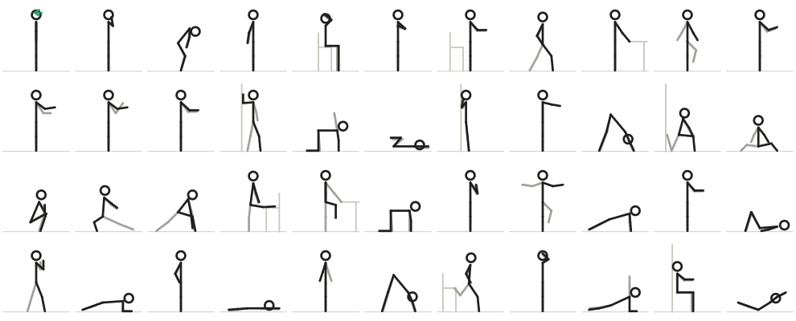

# Corpore Sano

### AI can take your job. It can't do your squats.

> *Orandum est ut sit mens sana in corpore sano.*
> Pray for a healthy mind in a healthy body.
> — Juvenal, *Satires* X, around 100 AD

> It is a disgrace to grow old through sheer carelessness before seeing what manner of man you may become by developing your bodily strength and beauty to their highest limit.
> — Socrates, in Xenophon's *Memorabilia* III.12

Let's be honest about where this is going. AI writes your code, your emails and your mum's birthday card. It thinks so you don't have to. You sit, you watch it type, you press Enter. Your attention span is shrinking, your spine is turning into a question mark, and the only muscle you still train is the finger that clicks **Allow**.

But there is one thing no model can take from you. Not the next one, not the one after that, not the one running in a datacenter on the Moon.

**Your muscles.** 💪

And when the machines finally take over the world, you will be glad you kept them. Someone has to carry the servers out. Someone has to outrun the robot vacuum. Someone has to open the jar the robot can't grip. It might as well be you.

**Corpore Sano turns the time Claude spends working into a short workout.** Every 45 minutes, the next time Claude starts a longer task, an animated figure appears above your prompt with an exercise and a timer. Claude does your work. You do the squats. The deal finally feels fair.



## What's inside

- **Easy**: 14 exercises standing or seated at the desk. No floor work, no sweat, nobody in the office notices.
- **Hard**: 16 mobility exercises that build range of motion. Some are on the floor, so wear comfortable clothes.
- **Beat AI**: 14 bodyweight strength exercises in 40 s sets with 20 s of rest, for as long as Claude's turn runs. Every set you finish is a point. Final score: `You 4 : 0 Claude`. For once, you win. (Skip and it's `You 0 : 1 Claude`.)
- **Hardcore** (optional): no Skip button, and your prompts wait until the workout is done. Claude can wait. Your glutes can't.

> **Health disclaimer, honestly.** I'm not a doctor, a physiotherapist or a personal trainer. I'm not even a student training to be one. I'm someone who sits at a desk far too much and built this to make myself move. So none of this is medical advice.
>
> Stretches should be felt, never painful. Stop if anything hurts, tingles or goes numb. If you have an injury or a health condition, or you're simply not sure an exercise is right for you, ask someone who actually studied this: a doctor or a physiotherapist. You use this at your own risk.

## Install

At the prompt of a Claude Code terminal session:

```
/plugin install corpore-sano --marketplace GallAn0nim/CorporeSano
```

Answer `y` to add the marketplace, then pick a scope (user scope loads it in every session, desktop app included).

From a shell:

```bash
claude plugin install corpore-sano --marketplace GallAn0nim/CorporeSano
```

In the desktop app, where `/plugin` does not run: click **+** next to the prompt box, then **Plugins**, **Add marketplace** with `GallAn0nim/CorporeSano`, then **Add plugin**.

The mod draws in the desktop app only. In a terminal session it still counts work time, but shows nothing.

## How it works

1. **Work counter.** It starts at your first prompt of the day and counts up across every open session. Lunch counts as work: there is no idle reset.
2. **Due.** After `workMinutes` (45 by default) a workout is due. A toast says so.
3. **The workout.** Easy and Hard: three exercises, one each for the upper body, the lower body, and wrists and balance, none repeated from your previous workout. Beat AI: one exercise per set, in rotation.
4. **A good moment.** The workout starts when a Claude turn is still running 60 seconds after it started, so you move while the agent works. If no such turn comes within 10 minutes, it starts anyway.
5. **The bar.** Above the prompt: an animated figure, the exercise, a timer, and **Done** (unlocks when the timer reaches 0), **Swap** (another exercise from the same group) and **Skip** (ends the workout). Per-side exercises say *Switch sides* at half time.
6. **The end.** Finished, skipped or failed, the work counter goes back to zero.

A workout is shared by every open session: finishing it in one closes it everywhere. A Beat AI match plays against the turn of the session it started in; turns in other sessions do not end it.

### Hardcore

- No Skip button.
- While a workout is active, prompts you type are held back with *Finish your workout first: 1 of 3 done.* After the workout, **Send saved prompt** sends them (in the session where you typed them). Slash commands and permission answers are never held, so the agent never stalls because of the mod.
- Turning the mod off during a workout needs the phrase **I give up** and counts as a failed workout.
- Easy and Hard exercises come from a shuffle bag instead of one per group: every exercise comes up once before any repeats.

## The panel

Type `/corpore-sano` to open the side panel. It is the only place settings are changed. Top to bottom: what the mod does, **Turn on** (turning off asks for 1 h, 2 h or until tomorrow; it turns itself back on after that, with the work counter reset), **Working**, **Today** (exercises beaten, workouts failed, the last Beat AI score), **Settings**, the exercise list with a checkbox per exercise, and the health disclaimer.

| Setting | Default | Meaning |
| --- | --- | --- |
| Level | Easy | Easy, Hard or Beat AI |
| Work before a workout | 45 min | 15 to 120 minutes of work before a workout is due |
| Swaps per workout | 3 | 0 to 10 |
| Hardcore | off | no Skip, prompts wait until the workout is done |
| Animated figures | on | off shows a still first pose (reduced motion) |
| Exercises | all on | untick an exercise and it never comes up |

Settings are kept across sessions. A change applies from the next workout.

## Add or change exercises

All exercises live in [`data/exercises.json`](data/exercises.json): a set of base poses, then one list per level (`easy`, `hard`, `beatAi`). Restart the session (or reload the mod) after editing it.

```jsonc
{
  "id": "chin-tucks",            // kebab-case, unique across all levels
  "name": "Chin tucks",
  "description": "Slide your head straight back, making a double chin, hold 2 s, 8–10 reps.",
  "group": "upper",              // easy and hard: upper | lower | wrist-balance
  "seconds": 30,                 // easy and hard; Beat AI sets are always 40 s
  "perSide": true,               // optional: the bar says "Switch sides" at half time
  "base": "stand",               // stand | seated | quadruped | plank | supine | prone | sideLying
  "props": { "chair": { "x": 30, "facing": "right" } },   // optional: chair, desk, wall
  "arrow": [58, 12, 48, 12],     // optional: a green hint arrow, x1 y1 x2 y2
  "tempoMs": 900,                // time from one keyframe to the next
  "keyframes": [{}, { "h": [45, 15] }]   // 2 = back and forth, 3+ = a loop
}
```

**The pose rig.** A pose is 11 joints on a 100×100 canvas, seen from the side, the figure facing right, the floor at y = 93: `h` head centre, `n` neck/shoulder, `p` pelvis, `e` elbow, `w` wrist, `k` knee, `f` foot. Suffix `1` is the near side (drawn in full colour), `2` the far side (muted). A keyframe only lists the joints that differ from the exercise's base pose.

**Check and preview.** With Node 23.6 or newer:

```bash
node scripts/check-data.mjs --preview
```

It checks ids, groups, joints and figure sizes, and writes `preview.html` with every figure animated. Open it in a browser. `node scripts/gallery.mjs` rebuilds the image at the top of this README.

Side-view figures only approximate front-view moves (`cossack-squat`, `ninety-ninety-transitions`, `standing-twist`), and the rig has no fingers (`fist-to-spread`). The description carries those.

## Develop

```bash
claude plugin validate .
claude plugin test .
tsc -p .
```

`tsc -p .` needs the engine's types in `.claude-plugin/types/`, which Claude Code writes the first time it loads the mod from this folder (`claude --plugin-dir .`).

- `hooks/logic.ts`: every rule as a pure function (counter, trigger, picking, swaps, Beat AI sets, Hardcore). No engine calls, so all of it is unit-tested.
- `hooks/register.tsx`: wires events to the logic and draws the bar and the panel.
- `hooks/figure.ts`: turns an exercise into SMIL-animated SVG.
- `types/index.d.ts`: shared types and the `$.state` contract.

With `CORPORE_SANO_DEV=1` in the environment, `/corpore-sano` takes developer arguments: `due` (the workout is due now), `start` (start one now), `show <exercise-id>` (show one exercise in the bar), `yesterday` (pretend the day record is old) and `reset`.

## Contributing

Everyone is welcome, and some of you more than others. Unlike me, you might be a personal trainer, a physiotherapist or a sports scientist. If so, you probably know a far better set of exercises for people who spend ten hours a day staring at a terminal than the one I put together. Please share it.

- **Better exercises**: add, fix or replace entries in [`data/exercises.json`](data/exercises.json) (see [Add or change exercises](#add-or-change-exercises)). A short note on why an exercise helps desk workers is very welcome.
- **Corrections**: if an exercise is described badly, risky for some people or simply useless, open an issue and say so. Plain words are fine.
- **Code**: bug fixes and new ideas are welcome too. Run `claude plugin test .` before opening a pull request.

The machines are coming. Help us get the programmers ready. 💪

## License

[MIT](LICENSE)
